  <picture>
    <source media="(prefers-reduced-motion: reduce)" srcset="assets/meadow-breathing.svg#still">
    
  </picture>

  <picture>
    <source media="(max-width: 650px)" srcset="assets/about-note-mobile.svg">
    
  </picture>
   
   
  
   

## GitHub snapshot

  <picture>
    <source media="(max-width: 650px)" srcset="assets/github-snapshot-mobile.svg">
    
  </picture>

## Selected projects

- [**NexBox**](https://github.com/MuLiuSaMa/NexBox) — A game toolbox for modern players: hardware monitoring, system tuning, crosshair overlay, floating monitor, and DLSS model tweaks.
- [**MeowCode**](https://github.com/MuLiuSaMa/MeowCode) — An agent with a freely editable architecture.
- [**OpenMD**](https://github.com/MuLiuSaMa/OpenMD) — A clean, beautiful, and efficient Markdown viewer.
